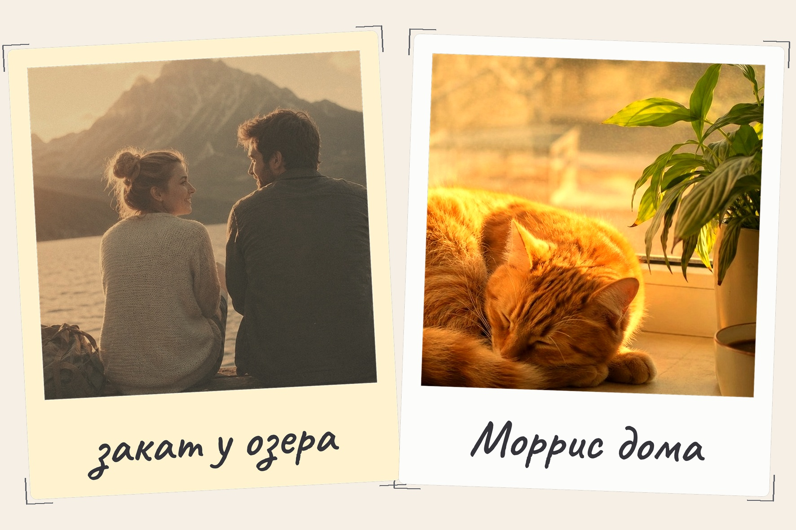

# Softpalaroid

Десктопное приложение (Windows), которое превращает обычные фотографии в
**полароидные снимки** и раскладывает их на **листе 10×15 см** — готовом к
печати как обычное фото (300 DPI). Интерфейс — современный, тёмный,
в стиле соцсети X.


Пример готового листа (1772×1181 px, 300 DPI):



## Возможности

- 🖤 Современный интерфейс в стиле X: чёрная тема, шрифт Inter, акцент #1D9BF0
- 📐 Лист 10×15 см: альбомная (15×10) или книжная (10×15) ориентация
- 🖼️ **От 1 до 12** полароидов на листе: быстрые пресеты 1/2/4/6/9,
  произвольное количество, свободное добавление, дублирование и удаление
- ✂️ Плоский макет **без тени карточек** и с L-образными **уголками обреза**
  вокруг каждого полароида (печатаются на листе, при желании отключаются)
- 🎨 Цвет фона листа и цвет рамки каждой карточки: пресеты или произвольный цвет
- 📷 Практически любые растровые форматы фото: **JFIF**, JPG/JPEG, HEIC/HEIF,
  AVIF, PNG, WebP, GIF, BMP, TIFF, JPEG 2000, QOI, TGA, PSD и другие;
  формат распознаётся по содержимому файла, а не только по расширению,
  для анимированных изображений берётся первый кадр
- 🖱️ Редактирование **прямо в окне предпросмотра**:
  - масштаб фото внутри рамки — колесом мыши
  - наклон карточки — ручкой сверху, `Shift`+колесо или `Alt`+перетаскивание
  - поворот самого фото на 90° и отражение по горизонтали/вертикали
  - размер карточки, её слой (вперёд/назад) и центрирование на листе
  - сдвиг фото в рамке — перетаскиванием (или стрелками клавиатуры)
  - перемещение карточки по листу — перетаскиванием за белую рамку
  - масштаб просмотра листа — `Ctrl`+колесо
- ✍️ Подпись на белой рамке встроенным рукописным шрифтом Caveat (с кириллицей)
- 🎞️ Фильтры в стиле плёнки: винтаж, тёплый, холодный, выцветшая плёнка,
  сепия, ч/б (виньетка + зерно)
- 💾 Экспорт в **JPG/PNG с 300 DPI** — печатается как стандартное фото 10×15
- 🖨️ Печать 10×15 прямо из приложения
- 📂 Drag-and-drop и множественный выбор: можно добавить сразу несколько фото,
  новые карточки для них появятся автоматически
- 🗂️ Проекты **`.softpalaroid`**: композиция и копии фотографий в одном
  переносимом файле, список недавних проектов
- ↩️ **Undo/Redo** (`Ctrl+Z` / `Ctrl+Y`) и автосохранение с восстановлением
  работы после аварийного закрытия

| Действие | Как |
|---|---|
| Масштаб фото | колесо мыши над карточкой |
| Наклон | `Shift`+колесо, ручка ⤾ сверху, `Alt`+тянуть |
| Сдвиг фото | тянуть фото мышью / стрелки |
| Двигать карточку | тянуть за белую рамку |
| Масштаб просмотра | `Ctrl`+колесо, тянуть пустое место |
| Загрузить фото | двойной клик по карточке |
| Дублировать / удалить карточку | `Ctrl+D` / `Delete` на холсте |
| Отменить / повторить | `Ctrl+Z` / `Ctrl+Y` |
| Сохранить проект | `Ctrl+S` (экспорт листа — `Ctrl+E`) |

Все параметры также дублируются слайдерами на панели справа.

## Скачать установщик (Windows)

Готовый установщик собирается автоматически на GitHub Actions:

- стабильные версии — в разделе
  [Releases](https://github.com/gjjut/Softpalaroid/releases)
  (`Softpalaroid-Setup-<версия>.exe`);
- промежуточные сборки — **Actions → Build Windows installer →** выбрать
  запуск **→ Artifacts: Softpalaroid-Windows**.

## Запуск из исходников

Требуется Python 3.11+.

```bash
git clone https://github.com/gjjut/Softpalaroid.git
cd Softpalaroid
python -m venv .venv
.venv\Scripts\activate      # Windows (Linux/macOS: source .venv/bin/activate)
pip install -r requirements.txt
python run.py               # можно передать фото: python run.py photo.jpg
```

## Сборка .exe и установщика

На Windows одной командой (для установщика нужен
[Inno Setup 6](https://jrsoftware.org/isdl.php)):

```bat
packaging\build.bat
```

Результат: `dist\Softpalaroid\Softpalaroid.exe` (программа без установки) и
`dist\installer\Softpalaroid-Setup-<версия>.exe` (установщик).

Вручную:

```bash
pip install -r requirements.txt pyinstaller
pyinstaller packaging/Softpalaroid.spec --noconfirm
"C:\Program Files (x86)\Inno Setup 6\ISCC.exe" packaging\installer.iss
```

### Публикация релиза

1. Поднять версию в `src/softpalaroid/__init__.py` и `MyAppVersion` в
   `packaging/installer.iss`.
2. `git tag v0.6.0 && git push origin v0.6.0` — GitHub Actions соберёт
   установщик и прикрепит его к новому Release.

## Структура проекта

```
run.py                      — запуск из исходников
src/softpalaroid/
    model.py                — геометрия листа и полароида, раскладки 1–12 и метки обреза
    filters.py              — плёночные фильтры (Pillow)
    render.py               — рендер листа в 300 DPI для экспорта/печати
    image_io.py             — загрузка изображений и регистрация кодеков
    project_io.py           — формат проектов .softpalaroid (ZIP + manifest)
    canvas.py               — интерактивный предпросмотр (мышь, наклон, масштаб)
    main_window.py          — главное окно и панель настроек
    theme.py                — тёмная тема в стиле X, подключение шрифтов
    resources.py            — пути к ресурсам assets (исходники и exe)
    app.py                  — точка входа
assets/fonts/               — шрифты Inter и Caveat (OFL, с кириллицей)
assets/icons/               — служебные иконки интерфейса
packaging/
    Softpalaroid.spec       — PyInstaller (Softpalaroid.exe)
    installer.iss           — Inno Setup (установщик)
    build.bat               — сборка в одну команду
tools/                      — генерация иконки, GUI smoke-тест для CI
tests/                      — unit-тесты ядра
.github/workflows/          — автосборка установщика на Windows
```

## Тесты

```bash
python -m unittest discover -s tests -v
QT_QPA_PLATFORM=offscreen python tools/smoke_gui.py   # GUI-прогон
```

## Стек

Python 3.11+ · [PySide6 (Qt)](https://doc.qt.io/qtforpython-6/) ·
[Pillow](https://pillow.readthedocs.io/) и pillow-heif · шрифты Inter и Caveat (OFL) ·
[PyInstaller](https://pyinstaller.org/) · [Inno Setup](https://jrsoftware.org/isinfo.php)

## Планы

- поддержка камерных RAW (CR2/NEF/ARW);
- неквадратное окно фотографии и другие форматы карточек;
- дополнительные шрифты, размер и цвет подписи.
