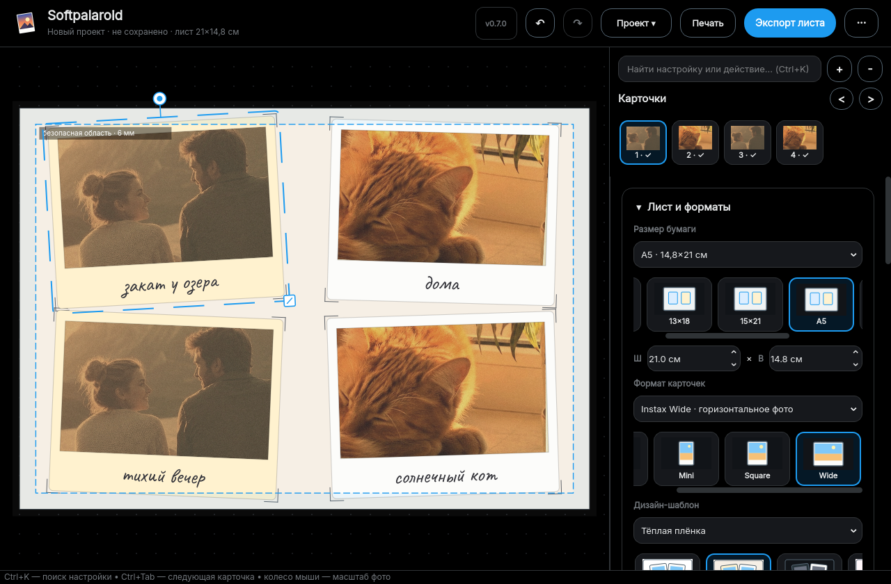
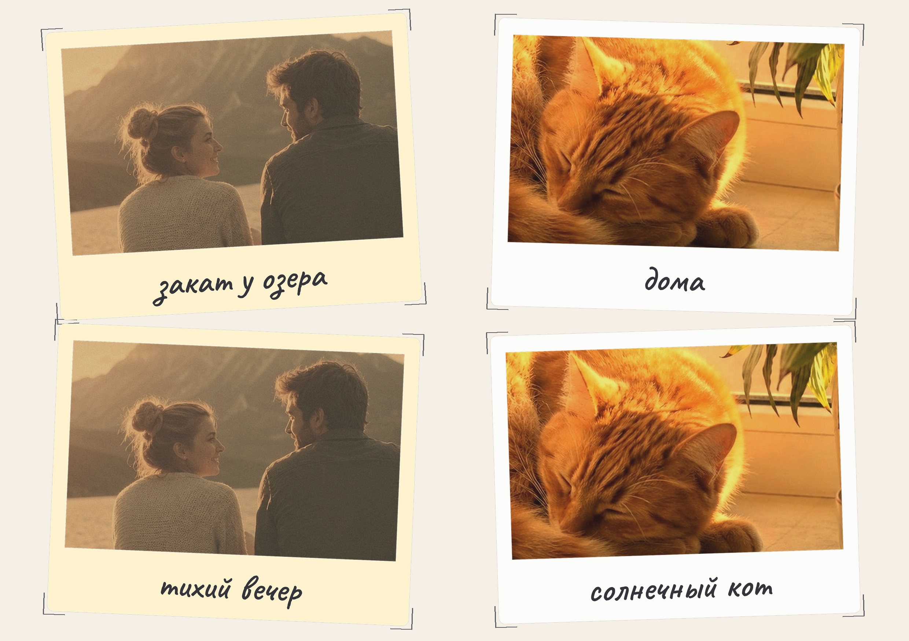

# Softpalaroid

Десктопное приложение (Windows), которое превращает обычные фотографии в
**полароидные карточки** и раскладывает их на печатных листах **10×15, 13×18,
15×21, A5, A4** или произвольном размере в разрешении 300 DPI. Интерфейс —
современный, тёмный, в стиле соцсети X.



Пример готового листа A5 с карточками Instax Wide (2480×1748 px, 300 DPI):



Классический образец 10×15 также сохранён:
[docs/sample_10x15.jpg](docs/sample_10x15.jpg).

## Возможности

- 🖤 Современный интерфейс в стиле X: чёрная тема, шрифт Inter, акцент #1D9BF0
- 🧭 Навигация по инспектору без бесконечной прокрутки: независимые
  сворачиваемые разделы запоминают состояние, а `Ctrl+K` мгновенно находит
  настройку или действие и раскрывает нужный раздел
- 🖼️ Визуальный выбор бумаги, формата карточек и дизайн-шаблонов по
  миниатюрным превью; плёночные фильтры также показываются галереей, причём
  на текущей фотографии, а точные значения остаются в выпадающих списках
- 🎞️ Закреплённая лента карточек над настройками: миниатюра, номер, статус
  файла и предупреждение о низком DPI; переход — щелчком, `Ctrl+Tab`,
  `Ctrl+Shift+Tab` или `PageUp`/`PageDown` на холсте
- 💡 Выбранные бумага, формат карточек, ориентация, шаблон, безопасная область,
  магниты и фон используются как стартовые параметры следующего проекта
- 📐 Бумага 10×15, 13×18, 15×21, A5, A4 или произвольные ширина и высота;
  альбомная и книжная ориентация
- 🃏 Форматы карточек: классический Polaroid, Instax Mini, Instax Square и
  Instax Wide — с квадратным, вертикальным или горизонтальным окном фото
- 🖼️ **От 1 до 12** полароидов на листе: быстрые пресеты 1/2/4/6/9,
  произвольное количество, свободное добавление, дублирование и удаление
- ✂️ Плоский макет **без тени карточек** и с L-образными **уголками обреза**
  вокруг каждого полароида (печатаются на листе, при желании отключаются)
- 🎨 Цвет фона листа и цвет рамки каждой карточки: пресеты или произвольный цвет;
  готовые дизайн-шаблоны листа и карточек
- 📷 Практически любые растровые форматы фото: **JFIF**, JPG/JPEG, HEIC/HEIF,
  AVIF, PNG, WebP, GIF, BMP, TIFF, JPEG 2000, QOI, TGA, PSD и другие;
  формат распознаётся по содержимому файла, а не только по расширению,
  для анимированных изображений берётся первый кадр
- 🎞️ Камерные **RAW** через LibRaw/rawpy: DNG, CR2/CR3, NEF, ARW, RAF, RW2,
  ORF и другие; встроенный ICC-профиль преобразуется в sRGB, экспорт также
  получает sRGB ICC
- 🖱️ Редактирование **прямо в окне предпросмотра**:
  - масштаб фото внутри рамки — колесом мыши
  - наклон карточки — ручкой сверху, `Shift`+колесо или `Alt`+перетаскивание
  - поворот самого фото на 90° и отражение по горизонтали/вертикали
  - размер карточки — квадратной ручкой, слайдером или точным значением в см
  - её слой (вперёд/назад) и центрирование на листе
  - сдвиг фото в рамке — перетаскиванием (или стрелками клавиатуры)
  - перемещение карточки по листу — перетаскиванием за рамку со smart guides
    и притягиванием к краям, центру, безопасной области и соседним карточкам
    (`Alt` временно отключает магниты)
  - масштаб просмотра листа — `Ctrl`+колесо
  - контекстное меню карточки, копирование/вставка её стиля и экспорт
    отдельной карточки
- 🧭 Настраиваемая **безопасная область** в миллиметрах: показывается на холсте
  и сохраняется в проекте
- 🔍 Контроль печати: фактический DPI после кадрирования, бейджи низкого
  разрешения и preflight-проверка пустых/потерянных фото, выхода за лист,
  безопасной зоны, обрезанных меток и перекрытий — с предупреждением, но без
  блокировки экспорта и печати
- ✍️ Многострочная подпись рукописным шрифтом Caveat (с кириллицей): размер,
  выравнивание, автоматический или собственный цвет
- 🎞️ Фильтры в стиле плёнки с регулируемой силой и повторяемым зерном:
  винтаж, тёплый, холодный, выцветшая плёнка, сепия, ч/б; отдельно яркость,
  контраст, насыщенность и резкость
- 💾 Экспорт в **JPG/PNG/PDF с 300 DPI и sRGB ICC**
- 🖨️ Предпросмотр печати с точным размером выбранного листа
- 📦 Пакетная обработка: много фотографий автоматически раскладываются по
  нескольким листам JPG/PNG/PDF с выбранными бумагой, форматом и шаблоном
- 📂 Drag-and-drop, множественный выбор и `Ctrl+V` на холсте: можно добавить
  сразу несколько фото или изображение из буфера обмена; новые карточки для
  них появятся автоматически
- 🗂️ Проекты **`.softpalaroid`** формата v3: бумага, формат карточек, шаблон,
  безопасная область, настройки фото/подписи и копии фотографий в одном
  переносимом файле; проекты v1/v2 открываются с безопасными значениями по
  умолчанию, а установщик может ассоциировать расширение с приложением
- ↩️ **Undo/Redo** (`Ctrl+Z` / `Ctrl+Y`) и автосохранение с восстановлением
  работы после аварийного закрытия

| Действие | Как |
|---|---|
| Масштаб фото | колесо мыши над карточкой |
| Наклон | `Shift`+колесо, ручка ⤾ сверху, `Alt`+тянуть |
| Сдвиг фото | тянуть фото мышью / стрелки |
| Двигать карточку | тянуть за рамку; `Alt` отключает магниты |
| Размер карточки | квадратная ручка в правом нижнем углу |
| Масштаб просмотра | `Ctrl`+колесо, тянуть пустое место |
| Загрузить фото | двойной клик по карточке |
| Вставить фото из буфера | `Ctrl+V` на холсте / правый клик |
| Найти настройку или действие | `Ctrl+K` |
| Следующая / предыдущая карточка | `Ctrl+Tab` / `Ctrl+Shift+Tab`, лента карточек |
| Соседняя карточка на холсте | `PageDown` / `PageUp` |
| Проверить макет | `Ctrl+Shift+P` |
| Пакетная обработка | `Ctrl+Shift+B` |
| Дублировать / удалить карточку | `Ctrl+D` / `Delete` на холсте |
| Отменить / повторить | `Ctrl+Z` / `Ctrl+Y` |
| Сохранить проект | `Ctrl+S` (экспорт листа — `Ctrl+E`) |

Все параметры также дублируются слайдерами на панели справа.

## Скачать установщик (Windows)

Готовый установщик собирается автоматически на GitHub Actions:

- стабильные версии — в разделе
  [Releases](https://github.com/gjjut/Softpalaroid/releases)
  (`Softpalaroid-Setup-<версия>.exe`);
- промежуточные сборки — **Actions → Build Windows installer →** выбрать
  запуск **→ Artifacts: Softpalaroid-Windows**.

## Запуск из исходников

Требуется Python 3.11+.

```bash
git clone https://github.com/gjjut/Softpalaroid.git
cd Softpalaroid
python -m venv .venv
.venv\Scripts\activate      # Windows (Linux/macOS: source .venv/bin/activate)
pip install -r requirements.txt
python run.py               # можно передать проект или несколько фото
```

## Сборка .exe и установщика

На Windows одной командой (для установщика нужен
[Inno Setup 6](https://jrsoftware.org/isdl.php)):

```bat
packaging\build.bat
```

Результат: `dist\Softpalaroid\Softpalaroid.exe` (программа без установки) и
`dist\installer\Softpalaroid-Setup-<версия>.exe` (установщик).

Вручную:

```bash
pip install -r requirements.txt pyinstaller
pyinstaller packaging/Softpalaroid.spec --noconfirm
"C:\Program Files (x86)\Inno Setup 6\ISCC.exe" packaging\installer.iss
```

### Публикация релиза

1. Поднять версию в `src/softpalaroid/__init__.py` и `MyAppVersion` в
   `packaging/installer.iss`.
2. `git tag v0.7.0 && git push origin v0.7.0` — GitHub Actions соберёт
   установщик и прикрепит его к новому Release.

## Структура проекта

```
run.py                      — запуск из исходников
src/softpalaroid/
    model.py                — бумага, форматы карточек, геометрия, DPI и раскладки
    filters.py              — детерминированные плёночные фильтры и коррекции
    render.py               — рендер листа/карточки в JPG/PNG/PDF 300 DPI
    image_io.py             — растровые форматы, ICC→sRGB и RAW/LibRaw
    preflight.py            — проверка макета перед экспортом и печатью
    templates.py            — дизайн-шаблоны листа и карточек
    batch.py                — пакетная сборка нескольких листов
    project_io.py           — формат проектов .softpalaroid v3 (ZIP + manifest)
    canvas.py               — WYSIWYG-предпросмотр, ручки, guides и безопасная область
    dialogs.py              — диалоги preflight и пакетной обработки
    main_window.py          — главное окно и панель настроек
    widgets.py              — сворачиваемые разделы и визуальные галереи выбора
    theme.py                — тёмная тема в стиле X, подключение шрифтов
    resources.py            — пути к ресурсам assets (исходники и exe)
    app.py                  — точка входа
assets/fonts/               — шрифты Inter и Caveat (OFL, с кириллицей)
assets/icons/               — служебные иконки интерфейса
packaging/
    Softpalaroid.spec       — PyInstaller (Softpalaroid.exe)
    installer.iss           — Inno Setup (установщик)
    build.bat               — сборка в одну команду
tools/                      — генерация иконки, GUI smoke-тест для CI
tests/                      — unit-тесты ядра
.github/workflows/          — автосборка установщика на Windows
```

## Тесты

```bash
python -m unittest discover -s tests -v
QT_QPA_PLATFORM=offscreen python tools/smoke_gui.py   # GUI-прогон
```

## Стек

Python 3.11+ · [PySide6 (Qt)](https://doc.qt.io/qtforpython-6/) ·
[Pillow](https://pillow.readthedocs.io/), pillow-heif, rawpy/LibRaw и NumPy ·
шрифты Inter и Caveat (OFL) · [PyInstaller](https://pyinstaller.org/) ·
[Inno Setup](https://jrsoftware.org/isinfo.php)

## Планы

- собственные пользовательские дизайн-шаблоны;
- дополнительные рукописные шрифты и текстовые стили подписи;
- макеты для фотокниг и пресеты конкретных фотопринтеров.
